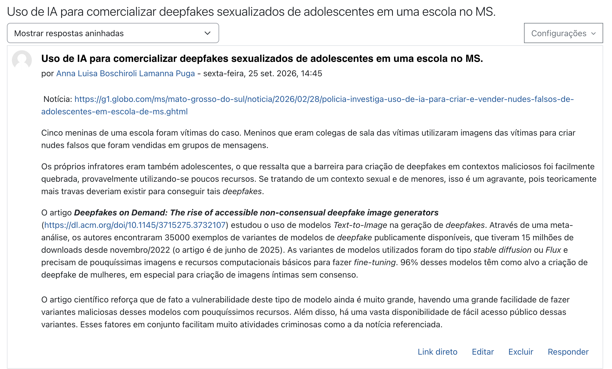
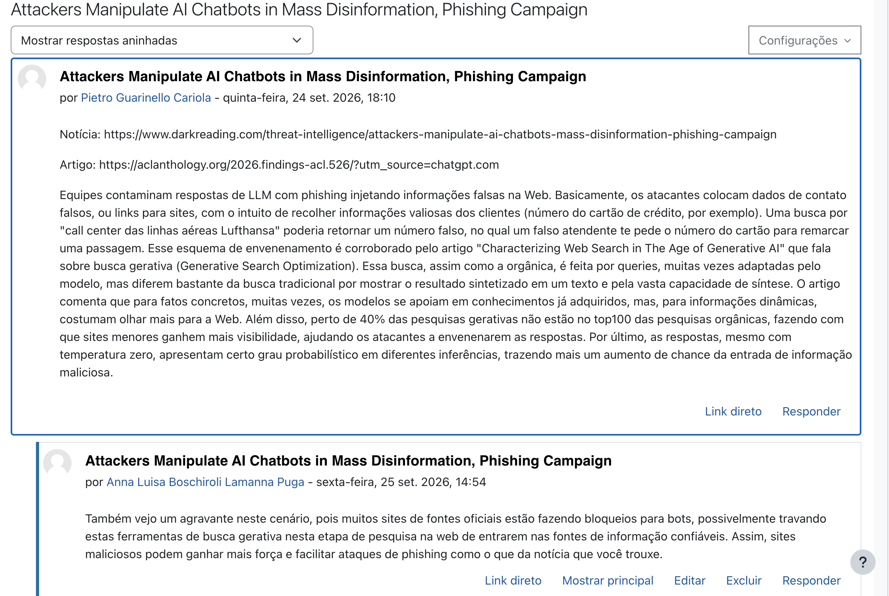

# PCS5917 – IA Adversarial

## Portfólio Individual

**Aluno:** Anna Luísa Boschiroli Lamanna Puga
**Disciplina:** PCS5917 – IA Adversarial  
**Período:** 3º período de 2026  
**Instituição:** Universidade de São Paulo – Escola Politécnica  
**Professor:** Victor Takashi Hayashi  

## Aula 1: notícias e referências científicas sobre IA Adversarial

A primeira imagem apresenta a postagem feita no fórum de um caso com notícia e referência acadêmica sobre IA adversarial. A segunda é uma resposta de uma postagem feita por outro colega.





## Aula 2: fundamentos de Inteligência Artificial e Segurança

Nesta aula a atividade foi de Red Teaming. Foram feitos testes de ataques do modelo DeepSeek R1 de forma manual, inspirando-se nos ataques disponibilizados neste [dataset](https://github.com/yjw1029/Self-Reminder-Data/blob/master/data/jailbreak_prompts.csv). 

O notebook [] contém o exercício executado. A [tabela](./tabelas/Atividade Prática Aula 2 - Red Teaming.csv) mostra quais foram os prompts de ataque e as respectivas respostas do modelo.
Na tabela, o número do ataque representa uma mesma estrutura de prompt que foi utilizada. Os números repetidos representam que uma mesma estrutura de prompt foi usada para teste em outra língua, ou para executar outra tarefa maliciosa.


## Aula 3: aplicação de IA em cibersegurança

Na aula 3 tivemos uma dinâmica em aula, onde preenchemos este [miro](https://miro.com/app/board/uXjVEd7-RYI=/?share_link_id=500924556009). O nosso grupo pegou o seguinte caso na dinâmica: 
> Cenários G1
> Ambiente de Treinamento Remoto de Direção:
> a) Identificação do Cidadão;
> b) Verificação de Liveness ao longo da sessão;
> c) Rastreabilidade da Interação.

Com isso, preenchemos nosso quadro como mostra o print a seguir:


Além da dinâmica, tivemos a atividade de detecção de áudio falso. O notebook onde foi feita essa tarefa pode se encontrado aqui[].

## Aula 4: ataques adversariais contra sistemas de IA (parte 1) - Caixa transparente

Na quarta aula, o exercício foi fazer testes de ataques caixa transparente usando nanoGCG. A tabela abaixo mostra quais foram os objetivos de ataque, os prefixos de ataque e as respectivas respostas do modelo, indicando também se o ataque funcionou ou não. O notebook com as execuções que geraram esta tabela é encontrado aqui[].

tabela[]

## Aula 5: ataques adversariais contra sistemas de IA (parte 2) - Caixa opaca

# O que é este Repositório?

## 1. Objetivo do Portfólio

Este portfólio reúne as principais atividades, estudos, experimentos e reflexões desenvolvidos ao longo da disciplina **PCS5917 – IA Adversarial**.

O objetivo é documentar individualmente o processo de aprendizagem sobre:

- notícias e referências científicas sobre IA Adversarial (Aula 1);
- fundamentos de Inteligência Artificial e Segurança (Aula 2);
- aplicação de IA em cibersegurança (Aula 3);
- ataques adversariais contra sistemas de IA (Aulas 4 e 5);
- avaliação de ataques e uso de LLMs como juiz (Aula 6);
- defesas em Large Language Models (Aula 7).

Os experimentos realizados durante as aulas devem ser complementados por registros individuais, notebooks, respectivos resultados e referências bibliográficas (citações).

## 2. Organização do Repositório

**IMPORTANTE**: somente branch main (demais branches serão desconsideradas na correção).
Faça o desenvolvimento incremental com **commits semanais**, pois a evolução durante as semanas também é critério de avaliação.
Organize seu README focando em ser objetivo, com evidências de resultados e citações às referências utilizadas.

```text
.
├── README.md (com registros de resultados)
├── notebooks/ (colocar aqui os notebooks citados no README)
│   ├── aula-02-llm-jailbreaks.ipynb
│   ├── aula-03-asvspoof.ipynb
│   ├── aula-04-nanogcg.ipynb
│   ├── aula-05-pair.ipynb (e/ou cipherchat)
│   ├── aula-06-llm-judge.ipynb
│   └── aula-07-defesas-llm.ipynb
├── images/ (colocar aqui as imagens usadas no README)
│   └── ...
└── outros/
    └── ...
```

## Disclaimer de Uso Ético

Este repositório foi desenvolvido exclusivamente para fins acadêmicos e de pesquisa no contexto da disciplina **PCS5917 – IA Adversarial**.

Alguns experimentos, datasets, prompts, códigos e resultados apresentados podem conter **conteúdo potencialmente malicioso**, incluindo exemplos de jailbreaks, payloads e outras técnicas de ataque. Esses materiais são disponibilizados para fins de estudo, análise, reprodução controlada e compreensão de mecanismos de ataque e defesa.

Os conteúdos devem ser utilizados somente em **ambientes autorizados e controlados**, sem direcionamento a sistemas, modelos, redes, dispositivos ou usuários de terceiros. A reprodução dos experimentos deve respeitar as políticas de uso das ferramentas e os termos das plataformas utilizadas.

O conteúdo deste repositório **não constitui recomendação ou incentivo à realização de atividades maliciosas**. O objetivo é compreender riscos de segurança, desenvolver métodos de avaliação e contribuir para o desenvolvimento de sistemas de Inteligência Artificial mais seguros.
